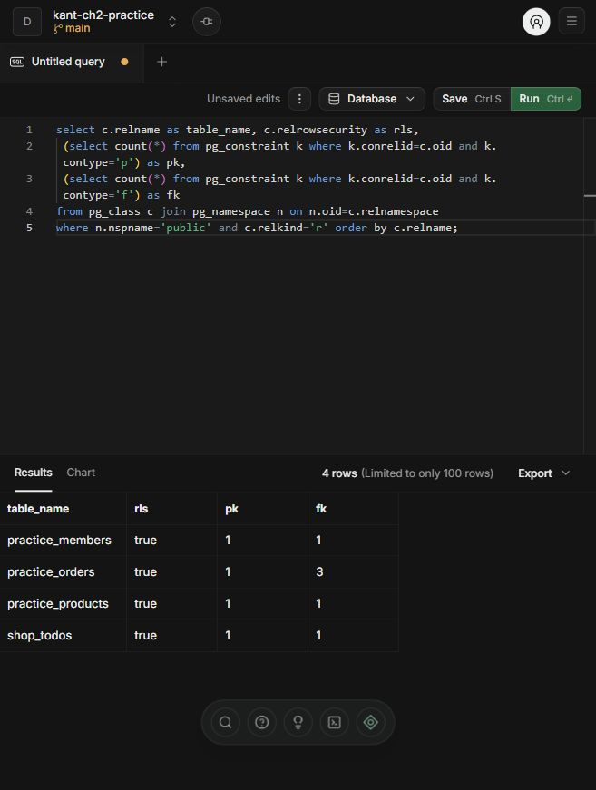
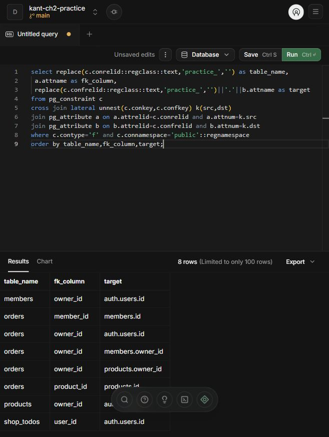
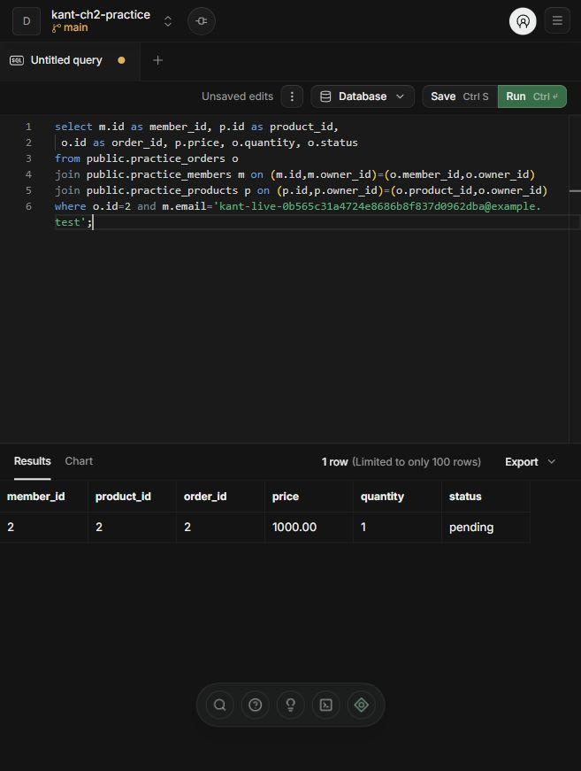
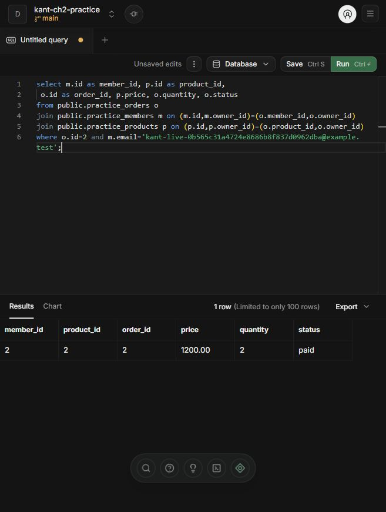
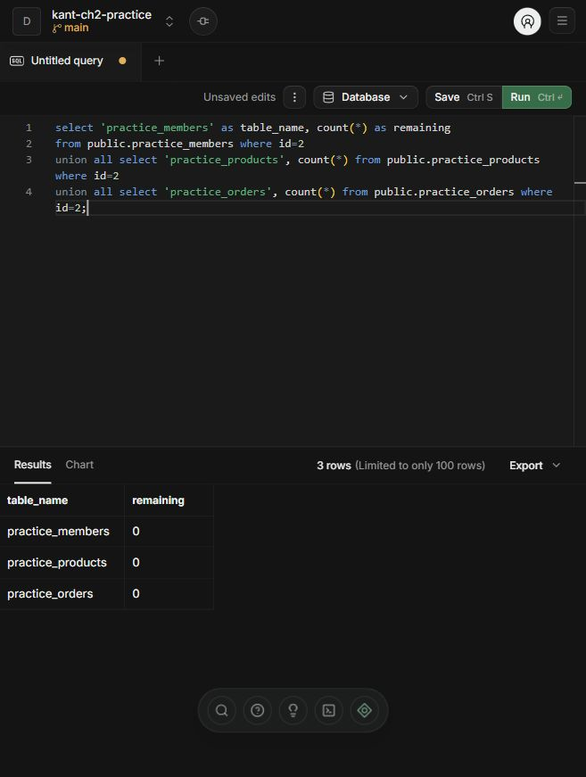
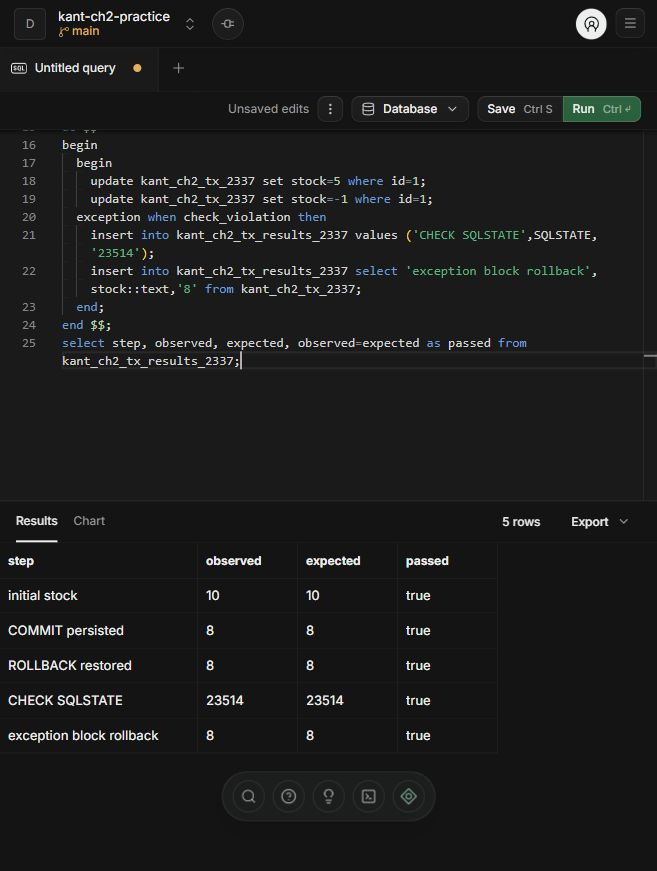

# Supabase 회원, 상품, 주문 CRUD

Python과 Supabase SDK로 쇼핑몰의 회원, 상품, 주문을 생성, 조회, 수정, 삭제하는 CH2 과제다. uv로 의존성을 고정하고 데이터 무결성은 PostgreSQL 제약조건, 사용자별 접근은 RLS로 관리한다.

**검증 상태:** 2026-11-16 실제 Supabase `kant-ch2-practice`에서 회원, 상품, 주문의 생성/조회/수정/삭제와 삭제 후 정리를 통과했다. 실제 PK/FK, 생성/조회, 수정, 삭제 화면과 [실행 로그](evidence/live-verification.jsonl)를 아래에 첨부했다. 실제 Supabase 임시 테이블의 트랜잭션 보충 검증 5개, SDK 호출 테스트 4개, 로컬 PGlite의 제약조건/RLS/COMMIT/ROLLBACK 검증도 통과했다.

## 실행

Python 3.13 이상과 uv가 필요하다.

```sh
uv sync --locked
uv run --locked python -m unittest -v
```

실제 연동은 전용 실습 프로젝트에 [schema.sql](schema.sql)을 한 번 적용하고, `.env.example`을 `.env`로 복사하여 아래 값을 설정한 다음 실행한다.

| 이름 | 용도 |
| --- | --- |
| SUPABASE_URL | 실습 프로젝트 URL |
| SUPABASE_PUBLISHABLE_KEY | 공개 클라이언트 키 |
| TEST_EMAIL | 가입과 이메일 확인을 마친 실습 계정 |
| TEST_PASSWORD | 해당 계정 비밀번호 |

```sh
uv run --locked python demo.py
```

키와 비밀번호는 Git에 포함하지 않는다. 로그인된 사용자 권한으로 검증하므로 service-role 키를 사용하지 않는다. 생성 SQL은 기존 테이블을 덮어쓰는 마이그레이션이 아니며 같은 프로젝트에서 중복 실행하지 않는다.

`demo.py`는 이미 설정된 프로세스 환경변수를 `.env`보다 우선 사용하므로, 실행 전 네 항목이 같은 실습 프로젝트와 계정인지 확인한다.

## 테이블과 관계

| 테이블 | PK | 데이터 | FK / 제약조건 |
| --- | --- | --- | --- |
| practice_members | id, bigint identity | name, email, owner_id | owner_id → auth.users.id, 사용자별 email 유일, 이름 1~80자 |
| practice_products | id, bigint identity | title, price, stock, owner_id | owner_id → auth.users.id, 제목 1~100자, 가격과 재고 0 이상 |
| practice_orders | id, bigint identity | member_id, product_id, quantity, status, created_at, owner_id | owner_id → auth.users.id, (member_id, owner_id) → practice_members(id, owner_id), (product_id, owner_id) → practice_products(id, owner_id), 수량 양수 |

주문 상태는 `pending / paid / cancelled`로 제한한다. 주문이 참조하는 회원과 상품은 먼저 삭제할 수 없다(`ON DELETE RESTRICT`). 삭제 시에는 주문을 먼저 지운다.

회원과 상품의 속성을 주문에 중복 저장하지 않고 FK로 연결한다. 이 실습의 주문 한 행은 상품 한 종류를 뜻한다. 여러 상품으로 구성되는 주문과 결제 시점의 가격 보존은 별도 주문 상세 모델이 필요한 확장 범위다.

테이블은 `practice_` 접두사, 컬럼은 snake_case로 통일했다. PK 인덱스와 별도로 주문의 두 복합 FK에 인덱스를 두었다.

## CRUD와 권한 설계

| 동작 | 구현 | 확인할 결과 |
| --- | --- | --- |
| 생성 | Store.create → insert → execute | DB가 생성한 ID와 저장된 행 반환 |
| 조회 | Store.read → select → eq → order | 전체 목록 또는 지정한 ID |
| 수정 | Store.update → update → eq | 지정 ID의 허용 필드만 변경 |
| 삭제 | Store.delete → delete → eq | 지정 ID 삭제 후 조회 결과가 빈 목록 |

[crud.py](crud.py)는 엔티티별 필드 목록과 필수값 검사를 공유한다. `id`, `owner_id`를 입력으로 덮어쓸 수 없고, 수정/삭제에는 양의 정수 ID만 허용한다. DB 오류는 호출자에게 전달하여 실패를 성공으로 처리하지 않는다.

RLS의 `USING`은 조회/수정/삭제할 기존 행을, `WITH CHECK`는 생성/수정 후 행의 소유자를 검사한다. 두 조건 모두 `auth.uid() = owner_id`다. 주문의 복합 FK는 다른 사용자의 회원이나 상품을 연결하는 것도 차단한다. 익명 역할에는 테이블 권한이 없다.

[demo.py](demo.py)는 세 테이블의 생성, ID 조회, 수정 결과를 검증한 뒤 자신이 만든 ID만 역순으로 삭제한다. 여러 SDK 요청은 하나의 DB 트랜잭션이 아니므로, 아래 SQL 트랜잭션 실습과 구분한다.

## 트랜잭션과 실패 재현

[transactions.sql](transactions.sql)은 같은 DB 세션에서 임시 테이블만 사용한다.

1. 재고 10 → 8 변경 후 COMMIT: 조회 결과 8.
2. 다음 트랜잭션에서 8 → 5 변경.
3. 재고 -1 변경으로 CHECK 위반을 의도적으로 발생.
4. ROLLBACK 후 재조회: 앞서 변경한 5도 취소되어 8.

실패 구문과 ROLLBACK은 같은 세션에서 구분해서 실행한다. 연결을 교체하면 임시 테이블과 진행 중인 트랜잭션 상태를 이어받을 수 없다.

위 원본 스크립트의 실패 후 별도 ROLLBACK 흐름은 로컬 PGlite에서 검증했다. 실제 Supabase SQL Editor에서는 [보충 SQL 배치](evidence/live-transaction.sql)를 실행하여 명시적 COMMIT/ROLLBACK과 PL/pgSQL 예외 블록의 복구를 확인했다. 보충 배치의 실행 범위와 실제 결과는 아래 트랜잭션 캡처에 정리했다.

## 확인 결과와 제출 증거

2026-11-16 확인:

| 검증 | 결과와 범위 |
| --- | --- |
| Python unittest | 4개 통과. 세 엔티티의 SDK 호출, ID 필터, 소유자 필드 주입 차단, 잘못된 ID와 필수값 검사 |
| 로컬 PGlite | 세 테이블 CRUD, FK 삭제 제한, 수량 CHECK, A/B 사용자 격리 통과 |
| 로컬 SQL 실패 시나리오 | PGlite에서 COMMIT 뒤 8, 실패 트랜잭션 내부 5, ROLLBACK 뒤 8 확인 |
| 실제 Supabase SQL 보충 배치 | 초기값 10, COMMIT 뒤 8, 명시적 ROLLBACK 뒤 8, CHECK SQLSTATE `23514`, 예외 블록 복구 뒤 8의 5개 결과 모두 통과 |
| 실제 Supabase Auth / SDK | 합성 A/B 계정 로그인 성공. 공개 키와 사용자 세션으로 회원/상품/주문 각각 CRUD 통과 |
| 실제 Supabase 회원별 권한 | 세 `practice_` 테이블에서 양방향 타인 조회/수정/삭제 차단 18개, 소유자 위조 INSERT/UPDATE 거부 12개, 타인 회원/상품 연결의 복합 FK 거부 4개 통과. 원소유자 데이터 불변 12회 확인 |
| 실제 Next Todo 권한 | 별도 실행의 `shop_todos`에서 양방향 타인 조회/수정/삭제 차단 6개, 소유자 위조 INSERT/UPDATE 거부 2개 통과 |
| 실제 CRUD 화면 캡처 | 아래 5장. PK/FK/RLS 설정, 생성/조회, 수정값, 삭제 후 세 테이블의 해당 ID가 0건임을 확인 |
| 테스트 데이터 정리 | 각 실행에서 생성한 DB/Todo ID만 정리하고 A/B 스크립트 세션을 local 범위로 로그아웃. DB 권한 추가 검증에서 생성한 6행도 역순 삭제 후 양 계정의 조회 결과 0건 확인 |

실제 CRUD와 회원별 권한 검사는 **publishable key + 로그인한 사용자 세션**으로 실행했다. 서버용 secret 키는 합성 A/B 계정 준비에만 사용했고 CRUD/RLS 검사에는 사용하지 않았다. A/B는 관리자 API에서 이메일 확인 상태를 지정한 실습 계정이므로, 이 결과는 로그인과 데이터 접근 검증이다. 앱 화면의 회원가입이나 확인 이메일 전달 절차를 검증한 것으로 표시하지 않는다.

## 실제 Supabase 실행 증거

실행 대상은 `kant-ch2-practice`의 `wtreqtufnuloqfusshvj.supabase.co`, CRUD/API 실행 시간은 2026-11-16 23:19:37~23:21:17 KST다. [JSONL 실행 로그](evidence/live-verification.jsonl)의 실행 ID는 `0b565c31a4724e8686b8f837d0962dba`다. 세 테이블에서 이번에 생성한 행의 ID는 각각 `2`이며, 동일한 ID를 조회/수정/삭제했다. 로그의 최종 결과는 검증과 정리 모두 `PASS`다.

아래 이미지는 실제 Supabase SQL Editor에서 조회한 화면이다. CRUD 요청은 이 저장소의 `Store`를 호출하는 SDK 검증으로 수행했고, 화면은 그 결과가 원격 DB에 반영되었음을 확인한다. 재현에는 위의 [demo.py](demo.py)를 사용한다. 로그에는 인증키, 비밀번호, 세션 토큰을 기록하지 않았다.

### PK, FK와 RLS 설정

세 실습 테이블에 PK가 각각 1개 있고 RLS가 활성화되어 있다. 주문은 사용자, 회원, 상품을 참조한다. 함께 표시된 `shop_todos`는 같은 실습 프로젝트의 Next Todo 테이블이다.



회원/상품의 소유자는 `auth.users.id`를 참조하고, 주문은 회원/상품의 ID와 소유자를 복합 FK로 연결한다.



### 생성과 조회

회원/상품/주문을 생성한 뒤 복합 FK 조건으로 JOIN하여 조회했다. 회원 ID `2`, 상품 ID `2`, 주문 ID `2`, 가격 `1000`, 수량 `1`, 상태 `pending`을 확인했다. 로그에는 세 테이블의 개별 ID 조회 결과도 포함되어 있다.



### 수정과 재조회

같은 상품/주문 ID의 가격이 `1200`, 수량이 `2`, 상태가 `paid`로 변경된 것을 재조회했다. 회원 이름 변경과 상품 재고 `3 → 2` 변경은 실행 로그의 `db_update` 결과에 기록되어 있다.



### 삭제와 재조회

주문을 먼저 삭제한 뒤 상품과 회원을 삭제했다. 이번 실행의 ID `2`를 각 테이블에서 다시 조회한 결과 모두 `0`건이다.



### 회원별 접근과 복합 FK

2026-11-16 23:40:13~23:40:31 KST에 같은 실제 Supabase 프로젝트에서 별도로 실행했다. [DB 권한 검증 로그](evidence/live-db-rls.jsonl)의 실행 ID는 `63935f60673e418681b8cd724e6d75e5`다. A/B가 각각 회원, 상품, 주문을 한 행씩 생성한 뒤 공개 키와 각자의 로그인 세션으로 검사했다.

| 검사 | 실제 결과 |
| --- | --- |
| 상대 회원의 행 조회/수정/삭제 | 3테이블, 양방향, 3동작의 18개 요청 모두 빈 결과 `[]` |
| 소유자 위조 INSERT/UPDATE | 3테이블, 양방향, 2동작의 12개 요청 모두 SQLSTATE `42501`로 거부 |
| 타인 회원/상품을 주문에 연결 | 양방향, 2개 참조의 4개 요청 모두 복합 FK의 SQLSTATE `23503`으로 거부 |
| 원소유자 재조회 | 상대 CRUD와 소유자 위조 시도 후 총 12회 원래 행이 변경되지 않았음 확인 |
| 테스트 행 정리 | 이번 실행에서 생성한 각 테이블의 ID `3`, `4` 총 6행만 주문 → 상품 → 회원 순으로 삭제. 양 계정에서 재조회한 12개 결과 모두 0건 |

로그의 최종 검증과 정리는 모두 `PASS`다. 이 추가 검증은 세 `practice_` 테이블만 대상으로 하며 기존 데이터와 Next Todo 행을 변경하지 않았다. 로그에는 계정 A/B 표시와 생성 ID, 결과만 기록하고 인증키, 비밀번호, 세션 토큰은 포함하지 않았다.

### COMMIT, ROLLBACK과 CHECK 실패

[live-transaction.sql](evidence/live-transaction.sql)은 실제 Supabase SQL Editor의 같은 실행에서 임시 테이블로 다음 결과를 확인한 보충 배치다.

| 검사 | 확인한 동작 | 결과 |
| --- | --- | --- |
| 초기값 | 재고 10 생성 | `10`, 통과 |
| 명시적 COMMIT | `BEGIN` 후 재고를 8로 변경하고 `COMMIT` | `8` 유지, 통과 |
| 명시적 ROLLBACK | `BEGIN` 후 재고를 5로 변경하고 `ROLLBACK` | `8` 복구, 통과 |
| CHECK 실패 | PL/pgSQL 내부 블록에서 재고를 5로 변경한 뒤 -1 변경 시도 | SQLSTATE `23514`, 통과 |
| 예외 블록 복구 | `check_violation`을 처리하면서 내부 블록의 변경을 취소 | 앞선 5 변경도 취소되어 `8`, 통과 |

마지막 두 검사는 PL/pgSQL `EXCEPTION` 블록의 복구 동작이다. 원본 `transactions.sql`의 실패 구문 실행 후 별도 명령으로 `ROLLBACK`하는 전체 세션 흐름은 위 로컬 검증 범위로 구분한다. 아래 실제 화면에서 보충 배치의 5행 모두 `passed=true`임을 확인할 수 있다.


